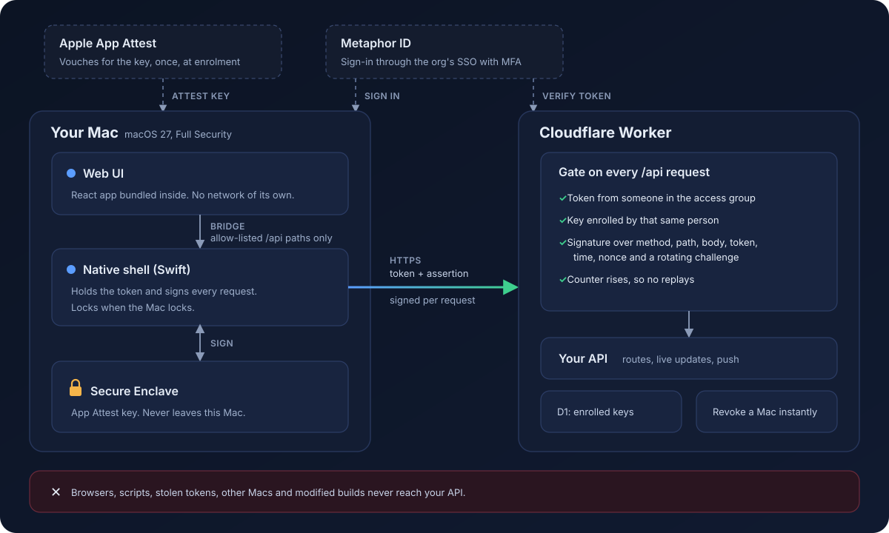

# macOS Secure App

A template for private business apps on the Mac where the backend only answers a genuine copy of
your app, on a Mac someone in your organisation has enrolled. Not a browser, not a script, not a
stolen password.



## Why not a web app or a normal Mac app

A web admin panel answers anyone with the right password or session cookie. Phish one person, or
lift a cookie, and the attacker works from their own laptop. A normal Mac app is no better: its API
calls can be copied into `curl`, and anything it ships with can be pulled out of the binary.

Here every request carries two things:

- **Who you are.** A token from [Metaphor ID](https://metaphor.id), signed in through your
  organisation's SSO with MFA, from someone in the access group.
- **What you're using.** An App Attest assertion from a key in this Mac's Secure Enclave. Apple
  vouched for the key when the Mac was enrolled: a genuine, unmodified build of your app, on real
  Apple hardware with Full Security on. The key can't be copied off the Mac, not even from a backup.

The signature covers the method, path, body, token, time, a nonce and a challenge the server
rotates, and a counter that must rise. So:

| Attack | Web app | Normal Mac app | This |
|---|---|---|---|
| Phished password or stolen token | Works from anywhere | Works from anywhere | Useless without an enrolled Mac |
| Copied request, replayed or edited | Often works | Often works | Refused |
| Script or `curl` against the API | Works with a token | Works with a token | Refused, sees a 404 |
| Modified or re-signed build | n/a | Works | Apple won't attest it |
| Injected script in the UI | Calls any API, sends data anywhere | n/a | No network of its own, allow-listed paths only |
| Lost laptop | Change the password, end sessions | Change the password, end sessions | Revoke that Mac, refused on its next request |

You still build the UI as a normal React app. The native shell does the security; your screens and
API routes don't have to think about it.

## What's in it

- `app/`: SwiftUI shell. Sign-in, enrolment, request signing, keychain storage, locks with the Mac.
  Also push notifications, a live update socket, downloads and an optional local MCP server so AI
  tools on the Mac can use the API with the same checks.
- `web/`: the React UI bundled into the app.
- `worker/`: Cloudflare Worker with the gate in front of every `/api` path, D1 for enrolled keys,
  a Durable Object for live updates, APNs for push, and an example notes API to replace.
- `shared/`: the request and bridge contracts, with test vectors both the Worker and the Swift app
  check against.

## Limits

- macOS 27 or later, with Full Security. Older Macs can't attest.
- Ship through TestFlight or as a Custom App in Apple Business Manager. Developer ID builds can't use
  App Attest.
- App Attest proves the app and the Mac are genuine, not the person. That's what SSO with MFA at
  enrolment is for.

## Getting started

```sh
npm install
npm run type-check && npm test       # shared, worker, web
npm run build:web                    # UI into app/Resources/WebApp
app/scripts/build.sh --xcode         # Swift tests and an unsigned app
```

Then make it yours with `scripts/rename.sh` and follow [docs/NEW-APP.md](docs/NEW-APP.md).
[docs/CONTRACT.md](docs/CONTRACT.md) has the wire contract, and [docs/runbook.md](docs/runbook.md)
covers running it: refusals, revoking Macs, offboarding and recovery.

## Licence

[MIT](LICENSE)
